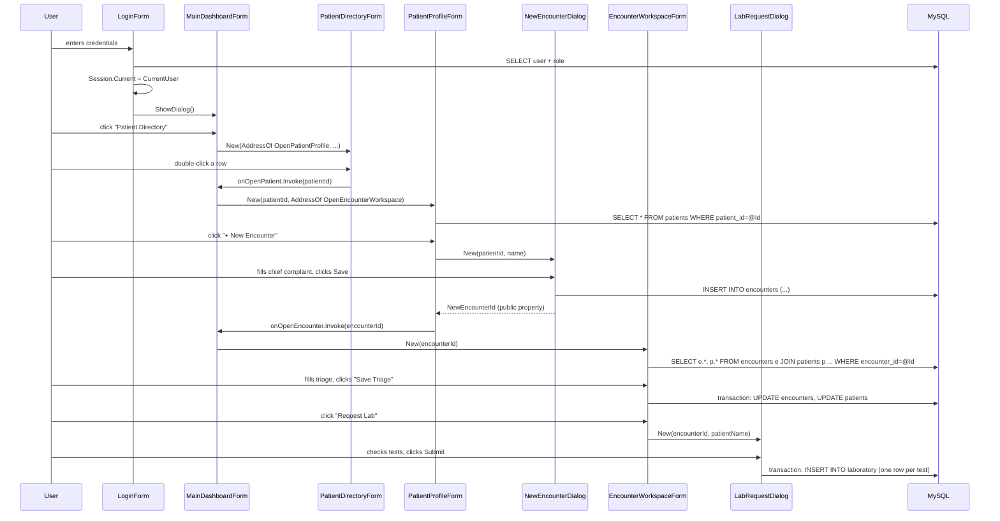
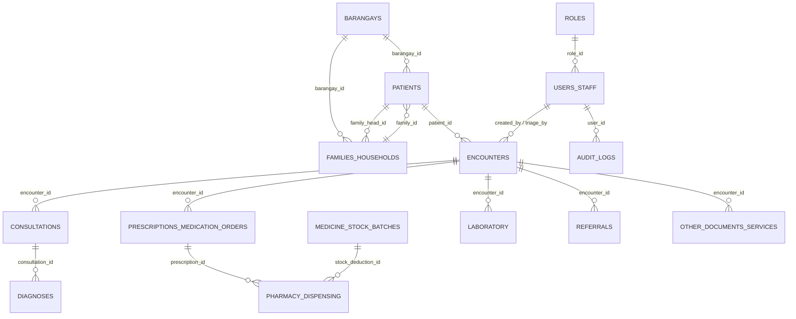

# Project C.A.R.E - How the pieces talk to each other

This explains the actual communication patterns in the codebase: how screens
pass data to each other, how the logged-in user is known everywhere without
being passed around explicitly, and how multi-step database writes stay
consistent. Written for whoever needs to explain or extend this system later.

## The three channels of communication

Everything in this app moves through exactly three channels. There is no
ORM, no shared in-memory cache, no message bus.

### 1. The database itself (`Data/Db.vb`, `Data/DbTransaction.vb`)

Every screen talks to MySQL through one module:

```vb
Db.Query(sql, params)              ' SELECT -> DataTable
Db.QueryScalar(sql, params)        ' SELECT -> single value
Db.Execute(sql, params)            ' INSERT/UPDATE/DELETE -> rows affected
Db.ExecuteInsertReturnId(sql, params) ' INSERT -> new AUTO_INCREMENT id
```

Each call opens its own connection, runs one parameterized statement, closes
the connection. Parameters are always passed as an anonymous object
(`New With {.Foo = bar}`) whose property names must match the `@Foo`
placeholders in the SQL — `Db`'s internal `AddParams` binds them by
reflection. This is also why the SQL is never built by concatenating user
input into the query text: search boxes, filters, everything goes through
`@Param` placeholders.

**No screen holds a live connection, and no two screens ever share one** —
every screen re-queries fresh data whenever it needs it, using whatever
IDs it was given (see channel 3 below).

For the handful of flows where several statements must succeed or fail
together, `DbTransaction` wraps one real MySQL transaction:

```vb
Using tx As New DbTransaction()
    tx.Execute(...)
    tx.Execute(...)
    tx.Commit()   ' must be explicit -- Dispose() without Commit rolls back
End Using
```

Every place that does this is commented with *why* those particular
statements need to be atomic. Current examples: dispensing a medication
(log the dispensing row + decrement the stock batch + flip the
prescription's status), saving triage vitals (update the encounter +
update the patient's cached vitals), submitting a multi-test lab request
(one row per test), setting a family head (clear the old head's flag + set
the new one), and saving a consultation (upsert the consultation + rewrite
its diagnoses + rewrite its medications + touch the encounter).

### 2. The logged-in user (`Models/Session.vb`)

`Session` is a `Module` (not a class you instantiate) holding one global:

```vb
Public Property Current As CurrentUser
```

`LoginForm` sets it once, after checking the password:

```vb
Session.Current = New CurrentUser With {.UserId = ..., .RoleName = ..., ...}
```

From that point on, **every other form reads `Session.Current` directly**
instead of having the current user passed into its constructor. That's how
`EncounterWorkspaceForm` knows who to record as `doctor_id`,
`DispenseMedicationDialog` knows who `dispensed_by` is, and `AuditLogger`
knows whose action it's logging — none of them were handed a "current
user" parameter; they all just read the same global. `MainDashboardForm`
clears it back to `Nothing` on logout.

### 3. IDs passed through callbacks (never whole objects)

This is the one that isn't obvious from looking at any single file, so
here's the actual mechanism.

**Forms never hold references to other forms.** They're wired together by
passing `Action`/`Action(Of Integer)` delegates into constructors.
`MainDashboardForm` is the only class that is ever allowed to construct
another screen and embed it in the content panel — every other screen that
wants to "navigate somewhere" does it by invoking a callback it was
handed, and lets `MainDashboardForm` do the actual construction.

Concretely, `PatientDirectoryForm`'s constructor is:

```vb
Public Sub New(onOpenPatient As Action(Of Integer), onRegisterNew As Action)
```

`MainDashboardForm.NavigateTo("patients")` constructs it like this:

```vb
childForm = New PatientDirectoryForm(AddressOf OpenPatientProfile, AddressOf OpenRegistration)
```

When the user double-clicks a row, `PatientDirectoryForm` doesn't know
anything about `PatientProfileForm` — it just does:

```vb
Dim id = Convert.ToInt32(grid.Rows(e.RowIndex).Cells("Id").Value)
onOpenPatient?.Invoke(id)
```

That call lands in `MainDashboardForm.OpenPatientProfile(patientId)`, which
is the only place that actually knows `PatientProfileForm` exists:

```vb
Dim frm As New PatientProfileForm(patientId, AddressOf OpenEncounterWorkspace)
```

**The only thing that ever crosses a screen boundary is a plain integer
ID.** `PatientProfileForm` never receives a `Patient` object — it receives
`patientId` and immediately re-queries the `patients` table itself in
`LoadPatient()`. This is deliberate: if screens passed each other cached
row data instead of IDs, editing a patient in one screen could leave a
different screen showing stale data. Re-querying by ID means every screen
always reflects the current database state, at the cost of an extra query
here and there — a cost that doesn't matter for a single-workstation app
talking to a local MySQL instance.

Modal dialogs (`NewEncounterDialog`, `LabRequestDialog`,
`IssueCertificateDialog`, `DispenseMedicationDialog`, etc.) follow the same
rule in miniature: they're constructed with the IDs they need, write
directly to the database themselves, and expose whatever new ID they
created as a public property (e.g. `NewEncounterDialog.NewEncounterId`) for
the caller to read after `ShowDialog()` returns `DialogResult.OK`.

## A full trace: registering a patient through to a lab request

Every arrow below is either "invoke a callback" or "construct a form/dialog
with an ID." Nothing here passes a row, a DataTable, or a cached object.



## The other navigation style: closures within one screen

Not all communication is cross-screen. Inside a single screen, filter
controls and their result grid talk to each other through a **closure**
captured once, not through callbacks. Every report in `ReportsForm.vb` and
its partial-class siblings follows this shape:

```vb
Dim grid = MakeGrid(100)
Dim refresh As Action =
    Sub()
        grid.DataSource = Db.Query(sql, New With {.From = dtpFrom.Value, ...})
    End Sub
AddHandler dtpFrom.ValueChanged, Sub() refresh()
AddHandler cboStatus.SelectedIndexChanged, Sub() refresh()
refresh() ' initial load
```

`refresh` closes over `grid`, `dtpFrom`, `cboStatus`, etc. — every filter
control's change handler just calls the same `refresh`, so there's one
place that knows how to rebuild the grid from current filter state, and
every control that can change that state triggers it. This is *within* one
`Panel`/form, never across the `MainDashboardForm` boundary.

## Data shape: how the tables connect

This is the FK chain every screen's re-query walks, at whatever point it
needs to join outward from an ID it was handed:



Every one of `encounter_id`, `patient_id`, `prescription_id` etc. that
shows up as a constructor parameter or a callback argument in the Forms
layer is one of the arrows in this diagram — the UI's ID-passing exactly
mirrors the FK structure underneath it.

## Where to add a new screen

If you add a new module screen that needs to open from another screen:

1. Give the new screen's constructor an `Action(Of Integer)` (or `Action`)
   parameter for whatever it needs to hand back to its caller (usually a
   newly created row's ID).
2. Add a private handler method to `MainDashboardForm` (e.g.
   `OpenSomethingNew(id As Integer)`) that constructs the new screen,
   embeds it via the same `TopLevel=False / Dock=Fill / pnlContent.Controls.Add`
   pattern every other case in `NavigateTo` uses, and pass
   `AddressOf OpenSomethingNew` into whichever screen should be able to
   trigger it.
3. Never have one module screen construct another module screen directly
   — always route through `MainDashboardForm`. Modal dialogs (popups that
   return via `ShowDialog()` and a `DialogResult`) are the exception; they
   can be constructed directly by whichever screen opens them, since
   they're not "navigation," they're a transient popup that returns control
   to the same screen.
